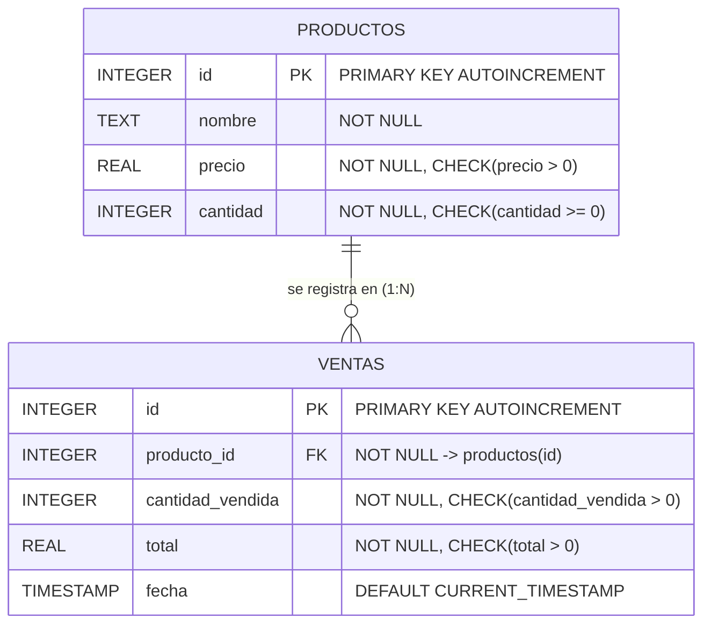
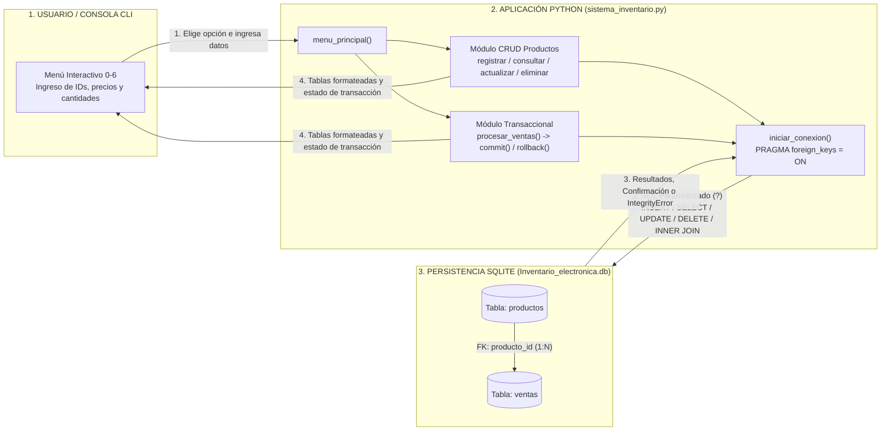
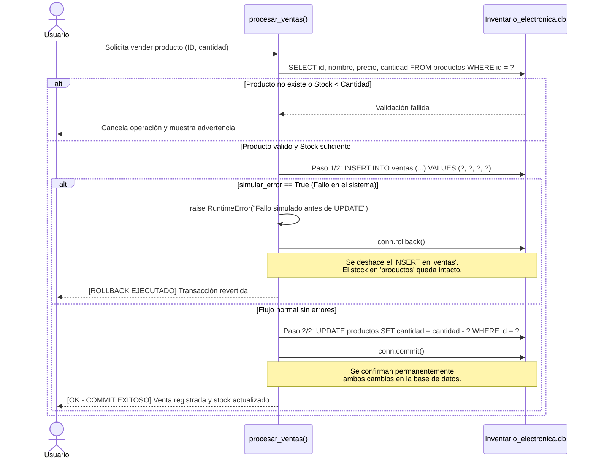

# 📦 Sistema de Inventario y Ventas - Componentes Electrónicos


* **Autor:** Santiago Enrique Noriega Garcia
* **Asignatura:** Acceso a Datos (Parcial Práctico 2026)
* **Temas:** Python, SQLite3, Operaciones CRUD, Integridad Referencial y Transacciones ACID (`COMMIT` / `ROLLBACK`).

---

## 📋 1. Contexto del Problema

Una tienda de componentes electrónicos presentaba dificultades críticas para controlar sus existencias: en diversas ocasiones se registraban ventas sin descontar las unidades correspondientes del inventario, generando inconsistencias en los datos contables y de stock.

Este proyecto soluciona dicho problema mediante una aplicación interactiva de consola (CLI) desarrollada en **Python** con persistencia en **SQLite** (`Inventario_electronica.db`). El sistema garantiza la integridad de la información mediante:
1. **Integridad referencial activa** (`PRAGMA foreign_keys = ON`).
2. **Consultas SQL parametrizadas** (`?`) para prevenir inyección SQL.
3. **Control transaccional atómico** (`commit()` y `rollback()`) que asegura que una venta y el descuento de stock ocurran juntos o no se aplique ninguno en caso de fallo.

---

## 🗄️ 2. Modelo de Datos

La base de datos `Inventario_electronica.db` se inicializa automáticamente al iniciar el programa y consta de dos entidades relacionadas en una proporción $1:N$ (un producto puede estar asociado a múltiples registros de venta).

### Diagrama Entidad-Relación (MER)



### Diccionario de Datos

#### Tabla `productos`
| Atributo | Tipo | Restricciones | Descripción |
| :--- | :--- | :--- | :--- |
| `id` | `INTEGER` | `PRIMARY KEY AUTOINCREMENT` | Identificador único de cada componente electrónico. |
| `nombre` | `TEXT` | `NOT NULL` | Nombre o referencia del componente electrónico. |
| `precio` | `REAL` | `NOT NULL CHECK(precio > 0)` | Precio unitario validado ($\text{precio} > 0$). |
| `cantidad` | `INTEGER` | `NOT NULL CHECK(cantidad >= 0)` | Unidades disponibles en inventario ($\text{cantidad} \ge 0$). |

#### Tabla `ventas`
| Atributo | Tipo | Restricciones | Descripción |
| :--- | :--- | :--- | :--- |
| `id` | `INTEGER` | `PRIMARY KEY AUTOINCREMENT` | Identificador único de cada registro de venta. |
| `producto_id` | `INTEGER` | `NOT NULL`, `FOREIGN KEY` | Clave foránea que referencia a `productos(id)`. |
| `cantidad_vendida` | `INTEGER` | `NOT NULL CHECK(cantidad_vendida > 0)` | Unidades vendidas en la transacción ($\text{cantidad\_vendida} > 0$). |
| `total` | `REAL` | `NOT NULL CHECK(total > 0)` | Valor total calculado ($\text{precio\_unitario} \times \text{cantidad\_vendida}$). |
| `fecha` | `TIMESTAMP` | `DEFAULT CURRENT_TIMESTAMP` | Fecha y hora exacta de la operación (`YYYY-MM-DD HH:MM:SS`). |

---

## 🏗️ 3. Arquitectura y Construcción del Software

El software está construido bajo una arquitectura modular de tres capas dentro de `sistema_inventario.py`, separando la interacción con el usuario, la lógica de negocio/transaccional y la capa de persistencia de datos.

### Diagrama de Arquitectura



### Estructura de Funciones del Código

1. **Configuración y Persistencia:**
   * `iniciar_conexion()`: Abre la conexión con `Inventario_electronica.db` y ejecuta `PRAGMA foreign_keys = ON` para obligar a SQLite a respetar las claves foráneas.
   * `inicializar_bd()`: Verifica y construye las tablas `productos` y `ventas` con sus restricciones `CHECK` si aún no existen.
2. **Módulo CRUD de Productos:**
   * `registrar_productos()`: Valida entradas por consola e inserta nuevos componentes electrónicos.
   * `consultar_productos()`: Lista el inventario ordenado por ID en un formato tabular alineado.
   * `actualizar_productos()`: Permite modificar únicamente el precio, únicamente el stock o ambos valores de un producto existente.
   * `eliminar_productos()`: Elimina un producto previa confirmación del usuario. Si el producto ya tiene ventas asociadas, captura la excepción `sqlite3.IntegrityError`, ejecuta `rollback()` e impide el borrado para proteger el historial contable.
3. **Módulo de Ventas y Transacciones:**
   * `procesar_ventas(producto_id, cantidad_vendida, simular_error=False)`: Contiene la lógica transaccional atómica.
   * `registrar_venta_menu()`: Captura los datos de la venta y ofrece la opción interactiva de simular un fallo del sistema para auditar el `rollback()`.
   * `mostrar_historial_ventas()`: Ejecuta una consulta con `INNER JOIN` entre `ventas` y `productos` para mostrar el detalle histórico con el nombre del componente.

---

## 🔄 4. Explicación de la Transacción y Manejo de `ROLLBACK`

Para evitar que una venta se registre sin descontar el inventario, la función `procesar_ventas()` agrupa las operaciones en una única transacción atómica:



### Paso a paso del flujo transaccional:
1. **Validación de entrada:** Se comprueba que el ID y la cantidad a vender sean enteros positivos ($\text{cantidad\_vendida} > 0$).
2. **Verificación de existencia:** Se consulta el producto por su `id`. Si no existe, se aborta antes de abrir cambios.
3. **Comprobación de stock:** Se evalúa si $\text{stock\_actual} < \text{cantidad\_vendida}$. Si no hay suficientes unidades disponibles, se informa al usuario y se detiene el proceso.
4. **Registro de la venta (Paso 1/2):** Se calcula el total y se ejecuta `INSERT INTO ventas`. En este instante inicia la transacción en SQLite (los cambios aún están pendientes de confirmación).
5. **Simulación de error controlado (Reto Obligatorio):** Si el usuario activa la prueba de fallo (`simular_error=True`), el programa lanza un `RuntimeError` inmediatamente después del `INSERT` en `ventas` y **antes** del `UPDATE` en `productos`.
6. **Actualización de inventario (Paso 2/2):** Si no hubo errores, se ejecuta `UPDATE productos SET cantidad = cantidad - ? WHERE id = ?`.
7. **Confirmación (`commit`) o Reversión (`rollback`):**
   * Si los pasos 1 y 2 finalizan sin percances, `conn.commit()` guarda ambos cambios de forma permanente.
   * Si ocurre el error simulado o cualquier excepción de base de datos, el bloque `except` invoca `conn.rollback()`, eliminando el registro temporal de `ventas` y garantizando que el inventario permanezca exactamente igual a como estaba antes de iniciar la operación.

---

## 🚀 5. Instrucciones de Ejecución

### Requisitos previos
* **Python 3.8 o superior** instalado en el sistema.
* No requiere instalar librerías externas con `pip` (utiliza los módulos nativos `sqlite3`, `os` y `datetime` de la librería estándar de Python).

### Pasos para ejecutar el programa

1. **Clonar el repositorio:**
   ```bash
   git clone <URL_DEL_REPOSITORIO>
   cd <NOMBRE_DE_LA_CARPETA>
   ```

2. **Ejecutar el script principal:**
   ```bash
   python sistema_inventario.py
   ```
   *(Al ejecutarse por primera vez, el sistema creará automáticamente el archivo `Inventario_electronica.db` en el mismo directorio del script).*

---

## 🖥️ 6. Evidencias de Ejecución

A continuación se documentan las pruebas ejecutadas en consola (las capturas gráficas completas también se encuentran adjuntas en el documento `PARCIAL AD 2026.pdf`).

### 6.1. Menú Principal y Registro de Productos (Opción 1)
```text
==================================================================
   SISTEMA DE INVENTARIO Y VENTAS - COMPONENTES ELECTRÓNICOS
==================================================================
1. Registrar producto
2. Consultar todos los productos
3. Actualizar producto
4. Eliminar producto
5. Registrar una venta
6. Mostrar historial de ventas
0. Salir
==================================================================
Seleccione una opción (0-6): 1

--- REGISTRAR NUEVO PRODUCTO ---
Nombre del componente electrónico: CPU RYZEN 7000 SERIES
Precio unitario ($): 2500000
Cantidad inicial en inventario: 15
[OK] Producto 'CPU RYZEN 7000 SERIES' registrado con éxito (ID asignado: 3).
```

### 6.2. Consulta del Inventario de Productos (Opción 2)
```text
--- INVENTARIO DE PRODUCTOS ---
ID    | COMPONENTE ELECTRÓNICO           |   PRECIO ($) |    STOCK
------------------------------------------------------------------
3     | CPU RYZEN 7000 SERIES            | $2,500,000.00 |       15
4     | RAM SAMSUNG 8 GB X2 3000 Mhz     | $  200,000.00 |       60
5     | Grafica GPU Nvidia Blackwell 2026| $4,500,000.00 |       20
------------------------------------------------------------------
```

### 6.3. Actualización de Producto (Opción 3)
Modificación del precio unitario de la memoria RAM (ID 4) pasando de $\$200,000.00$ a $\$150,000.00$:
```text
Ingrese el ID del producto que desea actualizar: 4

Producto seleccionado: RAM SAMSUNG 8 GB X2 3000 Mhz
Valores actuales -> Precio: $200,000.00 | Stock: 60
¿Qué desea modificar?
1. Solo Precio
2. Solo Cantidad (Stock)
3. Ambos (Precio y Cantidad)
0. Cancelar
Seleccione una opción (0-3): 1
Ingrese el nuevo precio ($): 150000
[OK] Producto 'RAM SAMSUNG 8 GB X2 3000 Mhz' actualizado con éxito. Nuevo precio: $150,000.00 | Nuevo stock: 60
```

### 6.4. Eliminación de Producto (Opción 4)
```text
Ingrese el ID del producto que desea eliminar: 5
¿Está seguro de que desea eliminar el producto 'Grafica GPU Nvidia Blackwell 2026' (ID: 5)? (s/n): s
[OK] El producto 'Grafica GPU Nvidia Blackwell 2026' (ID: 5) fue eliminado exitosamente.
```
*(Nota: Si se intenta eliminar un producto que ya cuenta con registros en la tabla `ventas`, el sistema bloquea la acción capturando `sqlite3.IntegrityError` para preservar la integridad referencial).*

### 6.5. Validaciones Previas en Ventas (Opción 5)

**Caso A: Producto inexistente (ID 99)**
```text
--- REGISTRAR NUEVA VENTA ---
Ingrese el ID del producto a vender: 99
Ingrese la cantidad de unidades a vender: 1
¿Desea forzar un error en el sistema antes de descontar stock para probar el rollback? (s/n) [n]: n
[!] Error: No existe el producto con ID 99.
```

**Caso B: Stock insuficiente (Solicitando 70 unidades cuando hay 60 disponibles)**
```text
--- REGISTRAR NUEVA VENTA ---
Ingrese el ID del producto a vender: 4
Ingrese la cantidad de unidades a vender: 70
¿Desea forzar un error en el sistema antes de descontar stock para probar el rollback? (s/n) [n]: n
[!] Advertencia: Stock insuficiente para 'RAM SAMSUNG 8 GB X2 3000 Mhz'. Disponibles: 60
Unidades solicitadas: 70
```

### 6.6. Demostración del Reto Obligatorio: Error Controlado y `ROLLBACK` (Opción 5)
Se intenta vender 10 unidades de `CPU RYZEN 7000 SERIES` (stock inicial: 15) forzando un fallo tras insertar en `ventas`:
```text
--- REGISTRAR NUEVA VENTA ---
Ingrese el ID del producto a vender: 3
Ingrese la cantidad de unidades a vender: 10
¿Desea forzar un error en el sistema antes de descontar stock para probar el rollback? (s/n) [n]: s

=== GENERANDO ERROR CONTROLADO Y DEMOSTRANDO ROLLBACK ===

[TRANSACCIÓN] Iniciando registro de venta para 'CPU RYZEN 7000 SERIES'...
  -> Paso 1/2 completado: Venta insertada en tabla 'ventas'.
  -> [!] Provocando error controlado antes de descontar el inventario...

[ALERTA - EXCEPCIÓN DETECTADA]: Fallo simulado de conexión/sistema después de INSERT en 'ventas' y antes de UPDATE en 'productos'.
[ROLLBACK EJECUTADO] Se canceló toda la transacción.
La venta NO fue guardada y el stock del producto permanece intacto.

--- VERIFICACIÓN AUTOMÁTICA DE INTEGRIDAD TRAS EL ROLLBACK ---

--- INVENTARIO DE PRODUCTOS ---
ID    | COMPONENTE ELECTRÓNICO           |   PRECIO ($) |    STOCK
------------------------------------------------------------------
3     | CPU RYZEN 7000 SERIES            | $2,500,000.00 |       15
4     | RAM SAMSUNG 8 GB X2 3000 Mhz     | $  150,000.00 |       60
5     | grafica nvidia blackwell 2026    | $4,500,000.00 |       10
------------------------------------------------------------------
```
Como se observa en la verificación automática, el stock de `CPU RYZEN 7000 SERIES` permanece intacto en **15 unidades** y la venta fallida no se registra en el historial.

### 6.7. Venta Exitosa (`COMMIT`) e Historial de Ventas con `INNER JOIN` (Opciones 5 y 6)
```text
[TRANSACCIÓN] Iniciando registro de venta para 'RAM SAMSUNG 8 GB X2 3000 Mhz'...
  -> Paso 1/2 completado: Venta insertada en tabla 'ventas'.
  -> Paso 2/2 completado: Inventario descontado en tabla 'productos'.
[OK - COMMIT EXITOSO] Venta registrada correctamente.
     Producto: RAM SAMSUNG 8 GB X2 3000 Mhz | Cantidad: 5 | Total: $750,000.00 | Nuevo stock: 55
```

**Consulta de Historial de Ventas (`INNER JOIN`):**
```text
--- HISTORIAL DE VENTAS ---
ID VENTA  | COMPONENTE ELECTRÓNICO       |  CANT. |    TOTAL ($) | FECHA Y HORA       
--------------------------------------------------------------------------------------
2         | RAM SAMSUNG 8 GB X2 3000 Mhz |      5 | $ 750,000.00 | 2026-10-20 11:47:09
1         | grafica nvidia blackwell 2026|      2 | $9,000,000.00| 2026-10-20 11:30:50
--------------------------------------------------------------------------------------
```

---

## 📂 7. Estructura del Repositorio

```text
├── sistema_inventario.py        # Código fuente principal de la aplicación
├── Inventario_electronica.db    # Base de datos SQLite (generada automáticamente)
├── PARCIAL AD 2026.pdf          # Informe detallado con diagramas y capturas de pantalla
└── README.md                    # Documentación técnica del repositorio
```